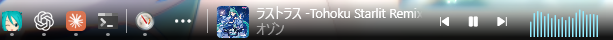

# Taskbar Margin

Shifts the taskbar **content** by a configurable number of pixels, leaving an empty margin on the left or on the right of the taskbar. The taskbar background stays full width, and with a left margin, the taskbar context menu follows the content.

Only the taskbar itself is affected.

 \
_Before_

 \
_After_

 \
_Right placement, with the FluentFlyout widget in the reserved space_

 \
_The context menu follows the margin_

## Settings

| Setting | Default | Description |
| --- | --- | --- |
| Placement | Left | Which side of the taskbar content the margin is placed on. The right side leaves the space between the app list and the system tray. |
| Left margin (pixels) | 220 | How much empty space to leave on the left of the taskbar content. |
| Right margin (pixels) | 350 | How much empty space to leave between the app list and the system tray. |
| Follow display DPI | on | Scale the margin with the display DPI, so it keeps the same visual size on high-DPI displays. Turn off to keep it at a constant physical pixel size. |
| Displays | All | Which displays the margin applies to: all, only the primary one, only the secondary ones, or only a specific one. Each display has its own taskbar and its own DPI, so the margin is calculated per display. |
| Specific display | \\.\DISPLAY1 | The device name of the display the margin applies to when Displays is set to "Specific display only". The comparison is case-insensitive, and an empty value matches no display. The device name of the display each taskbar is on is written to the mod log. |

## Notes

Requires Windows 11.

The taskbar must be:

- **left-aligned** (Settings → Personalization → Taskbar → Taskbar icon alignment)
- **Bottom** or **Top** (New in Windows 11 26H2, Settings → Personalization → Taskbar → Taskbar position)

The taskbar is not mirrored correctly on right-to-left display languages: the margin is applied to the chosen physical side regardless of the taskbar's flow direction, while the context menu is moved to the right (with the left placement).

## Compatibility

- **TranslucentTB** is confirmed compatible and can be used alongside this mod.
- **Windows 11 Taskbar Styler** is not an alternative to this mod. It changes the taskbar itself, while this mod changes the position of the elements inside it. A taskbar restyled that way loses the taskbar's effects on the margin area, while this mod keeps them across the whole taskbar, margin included. It also cannot move the context menu (the jump list), which this mod does.
- **Taskbar Styler compatibility**: with themes that customize the taskbar button metrics (e.g. Lucent, or the MacDock themes in ramensoftware/windhawk-mods#6988), Explorer can restart-loop with the right placement on Windows 11 26H2 build 26300 - on secondary taskbars, and on the primary taskbar as well if the taskbar icon size has been raised above the default (e.g. with the Taskbar height and icon size mod). Setting MediumTaskbarButtonExtent=55 does not prevent this. The left placement is not affected.
- **Taskbar jump list on cursor pos** changes the same anchor point. Both mods offset it, so depending on the hook order the menu can open offset from the cursor. Use one or the other.
- Tested on Windows 11 26H2.

## Suggested use

For example, together with [FluentFlyout](https://github.com/unchihugo/FluentFlyout): enable the taskbar widget there, set its position to the bottom left corner, and turn on the fixed widget width. The taskbar elements then tile linearly instead of overlapping each other.

With the placement set to the right, the space is left between the app list and the system tray instead, and the tray itself does not move. That suits the FluentFlyout taskbar widget in its usual place at the bottom right corner: set the right margin to the widget's width, and the widget gets the reserved space instead of overlapping the app list.

## Implementation notes

The taskbar context menu (the jump list) is not laid out by XAML. Its anchor point is computed in `explorer.exe` by `CTaskListWnd::_ComputeJumpViewPosition` in `taskbar.dll`, and handed to the process that draws the menu. The point is in physical screen pixels.

Shifting the taskbar's XAML content therefore does not move the menu on its own, because the menu is not placed relative to it. The mod adjusts the anchor point instead, which is why it hooks that function.

## License

GPL-3.0. The taskbar XAML access is based on the [Start button always on the left](https://github.com/m417z/my-windhawk-mods) mod by m417z, which is also licensed under GPL-3.0.

## Feedback

Bug reports and feature requests are welcome in [Issues](https://github.com/loliri/windhawk-taskbar-margin/issues).
